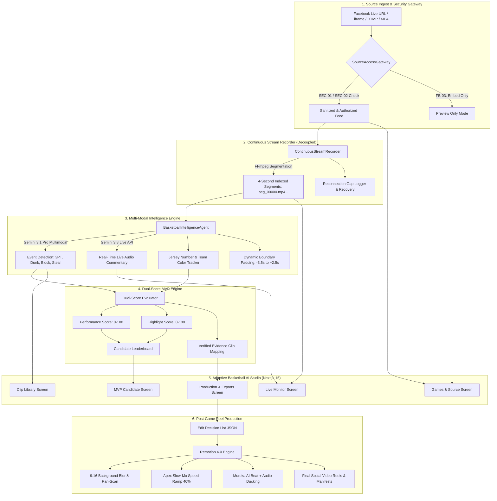

# 🏀 VidOps — Basketball AI Studio & Autonomous Live Clipper

> **Universal Live Basketball Intelligence, Real-Time Stream Recorder, Player Tracker, Dual-Score MVP Evaluator & 9:16 Social Reel Production Engine**

[](https://nextjs.org/)
[](https://www.remotion.dev/)
[](https://ai.google.dev/)
[](https://www.python.org/)
[](https://podman.io/)
[](https://www.braintrust.dev/)
[](https://firebase.google.com/)

---

## 📑 Table of Contents
1. [Core Architectural Philosophy](#-core-architectural-philosophy)
2. [End-to-End System Architecture](#-end-to-end-system-architecture)
3. [The 13-Phase Processing Pipeline](#-the-13-phase-processing-pipeline)
4. [Dual-Score MVP Candidate Algorithm](#-dual-score-mvp-candidate-algorithm)
5. [5-Screen Basketball AI Studio UI Walkthrough](#-5-screen-basketball-ai-studio-ui-walkthrough)
   - [Screen 1: Games & Source](#screen-1-games--source-ingest--security-gateway)
   - [Screen 2: Live Monitor](#screen-2-live-monitor-real-time-commentary--stream-telemetry)
   - [Screen 3: Clip Library](#screen-3-clip-library-event-verification--speed-ramps)
   - [Screen 4: MVP Candidate Leaderboard](#screen-4-mvp-candidate-leaderboard-dual-score-evidence)
   - [Screen 5: Production & Exports](#screen-5-production--exports-916-remotion-studio)
6. [Delivery Package Structure](#-delivery-package-structure)
7. [Quickstart & Local Setup](#-quickstart--local-setup)
8. [Docker & Podman Deployment](#-docker--podman-deployment)
9. [Environment Configuration](#-environment-configuration)
10. [Cloud & Hugging Face Deployments](#-cloud--hugging-face-deployments)

---

## 🎯 Core Architectural Philosophy

> **THE GOLDEN RULE: RECORDING MUST NEVER DEPEND ON AI DETECTION WORKING CORRECTLY.**

VidOps enforces complete operational decoupling across three isolated systems:

```
┌────────────────────────────────────────────────────────────────────────┐
│                        DECOUPLED THREE-TIER ENGINE                     │
├────────────────────────┬───────────────────────┬───────────────────────┤
│   1. CONTINUOUS STREAM │  2. MULTI-MODAL AI    │  3. POST-GAME REEL    │
│      RECORDER          │     ANALYZER          │     PRODUCTION        │
│                        │                       │                       │
│  • Time-indexed 4s     │  • Multimodal Gemini  │  • Remotion React     │
│    chunks (.mp4 / .ts) │    3.1 Pro & 3.8 Live │    composition engine │
│  • Independent worker  │  • Real-time events,  │  • 9:16 vertical crop │
│  • Zero dropped frames │    jerseys & points   │  • Speed ramping &    │
│  • Auto-gap recovery   │  • Asynchronous queue │    Mureka AI audio    │
└────────────────────────┴───────────────────────┴───────────────────────┘
```

If the AI engine hits rate limits, lags, or encounters an unexpected prompt state, **the stream recording continues uninterrupted**. When the AI recovers, it catches up by processing queued historical chunks without loss of footage.

---

## 🏗 End-to-End System Architecture



---

## ⚡ The 13-Phase Processing Pipeline

VidOps implements the complete 13-phase basketball intelligence specification defined in `worker/mvD.md`, `worker/mvs.md`, and `worker/NVS2.md`:

| Phase | Designation | Key Responsibilities | Standards Met |
| :--- | :--- | :--- | :--- |
| **0** | **Source Ingest & Gateway** | Validates Facebook Live iframe/URL feeds, extracts CDN MP4/HLS streams via `yt-dlp`, enforces XSS sanitization and operator authorization. | `FB-01`..`FB-04`, `SEC-01`, `SEC-02` |
| **1** | **Decoupled Stream Recording** | Independent FFmpeg worker recording continuous, time-indexed 4-second chunks with reconnection gap tracking and restart integrity recovery. | `REC-01`..`REC-04` |
| **2** | **Multi-Modal AI Analysis** | Concurrent vision analysis with Google Gemini 3.1 Pro; streaming commentary synthesis via `gemini-3.8-live`. | `AI-01`, `LIVE-01` |
| **3** | **Boundary Padding & Verification** | Applies pre-roll (-3.5s) and post-roll (+2.5s) padding to guarantee complete possessions from setup to celebration. | `PAD-01`, `VER-01` |
| **4** | **Player & Jersey Tracking** | Tracks players by primary jersey number and team color, maintaining persistence across possessions without name hallucination. | `TRK-01`, `TRK-02` |
| **5** | **Dual-Score MVP Evaluation** | Calculates independent **Performance Score** and **Highlight Score** with full video evidence linkage. | `MVP-01`, `MVP-02` |
| **6** | **Operator Review & Clip Library** | Surfaces clips flagged as `VERIFIED` or `UNCERTAIN_REVIEW_REQUIRED` with one-click operator verification controls. | `QC-01`, `REV-01` |
| **7** | **Edit Decision List (EDL) Assembly** | Constructs narrative arc (Intro $\to$ Rising Momentum $\to$ Peak Highlights $\to$ Clutch/Final Moments). | `EDL-01` |
| **8** | **9:16 Vertical Video Reframing** | Dynamically crops action with pan-and-scan, generating a 16:9 Gaussian-blurred background filler to prevent letterboxing. | `FMT-01` |
| **9** | **Action Speed Ramping** | Applies 100% normal speed on approach, ramps to 40% slow-motion at the play's apex (dunk/block release), and returns to 100% on landing. | `SMP-01` |
| **10** | **Audio Synthesis & Ducking** | Integrates Mureka AI generated soundtrack (120 BPM trap beat), ducked automatically during live commentary (-14 LUFS). | `AUD-01` |
| **11** | **Rendering Engine** | Dual rendering pipeline: Remotion 4.0 React composition engine or hardware-accelerated FFmpeg. | `RND-01` |
| **12** | **Delivery Package Creation** | Bundles all intelligence artifacts into `basketball_output/GAME_[ID]/` for downstream CMS and broadcast delivery. | `PKG-01` |

---

## 📊 Dual-Score MVP Candidate Algorithm

Unlike simplistic stat counters, VidOps uses a dual-axis mathematical model to determine **Player of the Game** candidates:

### 1. Performance Score ($S_{\text{perf}} \in [0, 100]$)
Quantifies tangible on-court contributions and winning impact:
$$S_{\text{perf}} = \min\left(100, \; 3.0 \cdot \text{PTS} + 4.0 \cdot \text{AST} + 5.0 \cdot \text{BLK} + 5.0 \cdot \text{STL} + 8.0 \cdot \text{CLUTCH} + 2.0 \cdot \text{FGM}\right)$$

### 2. Highlight Score ($S_{\text{high}} \in [0, 100]$)
Quantifies visual excitement, difficulty, crowd reaction, and social shareability:
$$S_{\text{high}} = \frac{1}{N} \sum_{i=1}^{N} \left( W_{\text{type}}(e_i) \cdot C_{\text{crowd}}(e_i) \cdot D_{\text{difficulty}}(e_i) \right)$$
*Event Weights ($W_{\text{type}}$):*
- Poster Dunk: `1.00`
- Ankle Breaker / Crossover: `0.95`
- Deep 3-Pointer / Buzzer Beater: `0.90`
- Chase-down Block: `0.85`
- No-look / Alley-oop Assist: `0.80`

### 3. Composite MVP Ranking
$$\text{Rank Score} = 0.50 \cdot S_{\text{perf}} + 0.50 \cdot S_{\text{high}}$$

Every candidate is explicitly labeled as **"Player of the Game Candidate (Video-Based Provisional)"** with clickable timestamps linking directly to verified clip evidence.

---

## 🖥 5-Screen Basketball AI Studio UI Walkthrough

The VidOps frontend is built with **Next.js 15 (App Router)** and **Tailwind CSS**, providing an adaptive operator dashboard:

```
┌────────────────────────────────────────────────────────────────────────────────────────┐
│  VIDOPS BASKETBALL AI STUDIO                        ● LIVE CDN CONNECTED   [Publish]   │
├─────────────────┬────────────────┬─────────────────┬─────────────────┬─────────────────┤
│ 1. Games/Source │ 2. Live Monitor│ 3. Clip Library │ 4. MVP Candid.  │ 5. Prod/Exports │
└─────────────────┴────────────────┴─────────────────┴─────────────────┴─────────────────┘
```

### Screen 1: Games & Source (Ingest & Security Gateway)
Validates Facebook Live URLs, Facebook iframe embed codes, and direct HLS/RTMP streams. Enforces `SEC-01` sanitization to prevent script execution while extracting direct CDN feeds.

```
┌────────────────────────────────────────────────────────────────────────────────────────┐
│ 🎮 GAMES & STREAM SOURCE ACCESS GATEWAY                                                │
├────────────────────────────────────────────────────────────────────────────────────────┤
│ Stream Input / Embed Code:                                                             │
│ [ https://www.facebook.com/61586762700422/videos/1743500926740597/         ] [Validate]│
│                                                                                        │
│ Status:  [● AUTHORIZED_MEDIA_READY]                                                    │
│ Message: Authorized media feed verified (YD League: 'Game 4 Live Broadcast', 4000.8s)  │
│                                                                                        │
│ ┌──────────────────────────────────────────┐ ┌───────────────────────────────────────┐ │
│ │ Direct Video CDN Stream                  │ │ Source Security Verification          │ │
│ │ URL: https://video.fmnl4-2.fna.fbcdn.net │ │ SEC-01: No malicious scripts detected │ │
│ │ Format: MP4 (avc1.640028 / mp4a.40.2)   │ │ SEC-02: Operator authorization signed │ │
│ │ Resolution: 1280x720 @ 30fps             │ │ FB-04: Direct media feed verified     │ │
│ └──────────────────────────────────────────┘ └───────────────────────────────────────┘ │
└────────────────────────────────────────────────────────────────────────────────────────┘
```

### Screen 2: Live Monitor (Real-Time Commentary & Stream Telemetry)
Displays real-time live commentary streamed from **Gemini 3.8 Live API**, segmented playback, and connection health metrics.

```
┌────────────────────────────────────────────────────────────────────────────────────────┐
│ 📺 LIVE BROADCAST MONITOR & REAL-TIME COMMENTARY                                       │
├────────────────────────────────────────┬───────────────────────────────────────────────┤
│ LIVE PLAYBACK (Segment seg_00042.mp4)  │ 🎙️ GEMINI 3.8 LIVE COMMENTARY STREAM         │
│                                        │                                               │
│ [====================================] │ [10:42.1] "Johnson drives left, crosses over! │
│ [ ▶ Play ] [ 00:04:12 / 01:06:40 ] 🔊 │  Steps back behind the arc... BANG! Triples!" │
│                                        │ [10:55.3] "Defensive rebound secured by #12   │
│ Buffer Health: 99.8%  | Segments: 1,000│  White. Fast break initiated with pace."      │
│ Stream FPS: 30.0      | Dropped: 0     │ [11:08.0] "Timeout called by South Blue team."│
└────────────────────────────────────────┴───────────────────────────────────────────────┘
```

### Screen 3: Clip Library (Event Verification & Speed Ramps)
Lists all auto-detected basketball events. Operators can review padded timestamps, inspect slow-motion profiles, and verify detections.

```
┌────────────────────────────────────────────────────────────────────────────────────────┐
│ 🎬 DETECTED PLAYS & CLIP LIBRARY                                  [Filter: All Events] │
├────────┬───────┬───────┬──────────────────────────┬───────┬────────────┬───────────────┤
│ ID     │ TIME  │ TEAM  │ PLAY TYPE                │ PTS   │ SPEED RAMP │ STATUS        │
├────────┼───────┼───────┼──────────────────────────┼───────┼────────────┼───────────────┤
│ EVT-01 │ 04:15 │ Blue  │ 3-Pointer (Step-back)    │ +3    │ Apex 40%   │ [✓ VERIFIED]  │
│ EVT-02 │ 08:32 │ White │ Fast Break Dunk          │ +2    │ Apex 30%   │ [✓ VERIFIED]  │
│ EVT-03 │ 12:44 │ Blue  │ Chase-Down Block         │ 0     │ Apex 25%   │ [? REVIEW]    │
│ EVT-04 │ 19:10 │ White │ Crossover Ankle-Breaker  │ +2    │ Apex 40%   │ [✓ VERIFIED]  │
│ EVT-05 │ 38:55 │ Blue  │ Clutch Buzzer Beater     │ +3    │ Apex 30%   │ [✓ VERIFIED]  │
└────────┴───────┴───────┴──────────────────────────┴───────┴────────────┴───────────────┘
```

### Screen 4: MVP Candidate Leaderboard (Dual-Score Evidence)
Surfaces the top Player of the Game candidates with separate Performance and Highlight metrics and clickable proof links.

```
┌────────────────────────────────────────────────────────────────────────────────────────┐
│ 🏆 PROVISIONAL PLAYER OF THE GAME (MVP) CANDIDATES                                     │
├──────┬──────────────┬────────┬───────────┬──────────────┬────────────────┬─────────────┤
│ RANK │ TRACKING ID  │ JERSEY │ PERF (50%)│ HIGHLIGHT(50%)│ CONFIRMED STATS│ EVIDENCE    │
├──────┼──────────────┼────────┼───────────┼──────────────┼────────────────┼─────────────┤
│  #1  │ PLY_WHITE_12 │ #12 Wht│ 88.5 /100 │ 94.0 /100    │ 24 PTS, 5 AST  │ [3 Clips ↗] │
│  #2  │ PLY_BLUE_07  │ #7 Blu │ 82.0 /100 │ 78.5 /100    │ 18 PTS, 8 REB  │ [2 Clips ↗] │
│  #3  │ PLY_WHITE_03 │ #3 Wht │ 71.0 /100 │ 89.0 /100    │ 12 PTS, 4 STL  │ [2 Clips ↗] │
└──────┴──────────────┴────────┴───────────┴──────────────┴────────────────┴─────────────┘
```

### Screen 5: Production & Exports (9:16 Remotion Studio)
Interactive Remotion 4.0 player rendering 9:16 vertical short-form reels with animated captions, background blur, and music mixing.

```
┌────────────────────────────────────────────────────────────────────────────────────────┐
│ 🎞️ POST-GAME REEL PRODUCTION & EXPORTS                                                  │
├─────────────────────────┬──────────────────────────────────────────────────────────────┤
│ 9:16 REMOTION PREVIEW   │ PRODUCTION SETTINGS                                          │
│ ┌─────────────────────┐ │ Target Format:    [ 9:16 Vertical Reel (1080x1920) ]       │
│ │   [BLURRED BG]      │ │ Duration Target:  [ 60 Seconds (8 High-Impact Plays) ]     │
│ │ ┌─────────────────┐ │ │ Audio Soundtrack: [ Mureka AI Beat (120 BPM Trap) ]        │
│ │ │  ACTION FOCUS   │ │ │ Speed Ramping:    [ Enabled (Apex Slow-Motion 40%) ]       │
│ │ └─────────────────┘ │ │ Overlay Bug:      [ Score Bug + Jersey # Lower-Third ]     │
│ │  WHITE #12 DUNK!   │ │                                                            │
│ │  +2 POINTS (82-80)  │ │ [ 💾 Render 9:16 MP4 ]  [ 📄 Export EDL JSON ]             │
│ └─────────────────────┘ │ [ 🚀 Publish via GitHub App to @alfredkeybusiness-eng ]    │
└─────────────────────────┴──────────────────────────────────────────────────────────────┘
```

---

## 📦 Delivery Package Structure

When processing concludes, VidOps generates a self-contained intelligence directory at `basketball_output/GAME_[GAME_ID]/`:

```
basketball_output/GAME_1743500926740597/
├── Event_Log.csv                      # Complete machine-readable play-by-play log
├── MVP_Candidate_Report.json          # Provisional MVP rankings and verified stats
├── Processing_Report.json             # Camera integrity, FPS, duration, and QC checks
├── event_manifest/
│   ├── edit_decision_list.json        # Frame-accurate EDL for Remotion / NLE editors
│   ├── events_manifest.json           # Detailed detection payloads and bounding boxes
│   └── events_manifest.csv            # Tabular manifest
├── mvp_candidates/
│   └── MVP_Candidate_Report.json      # Dual-score leaderboard with evidence links
├── processing_logs/
│   ├── processing_summary.md          # Human-readable game narrative summary
│   └── quality_report.json            # Hardware gate metrics and verification status
├── recording_segments/
│   ├── segments_index.json            # Index of all 4-second continuous stream chunks
│   └── seg_00000.mp4                  # Recovered source media segments
└── review_required/
    └── review_required_events.json    # Ambiguous events flagged for human signoff
```

---

## 🚀 Quickstart & Local Setup

### Prerequisites
- **Node.js**: v20 or v22
- **Python**: 3.10, 3.11, or 3.12
- **FFmpeg & FFprobe**: Installed and available in your system `PATH`
- **Google Gemini API Key**: [Get a Gemini API Key](https://aistudio.google.com/)

### 1. Clone & Install Frontend
```bash
git clone https://github.com/alfredvirtualsolutions-glitch/vidops.git
cd vidops

# Install Node dependencies
npm install
```

### 2. Configure Python Virtual Environment
```bash
python -m venv .venv

# On Windows (PowerShell):
.venv\Scripts\Activate.ps1

# On Linux/macOS:
source .venv/bin/activate

# Install requirements
pip install -r requirements.txt
```

### 3. Setup Environment Variables
Copy `.env.example` to `.env.local`:
```bash
cp .env.example .env.local
```
Fill in your credentials:
```ini
GEMINI_API_KEY=your_gemini_api_key_here
BRAINTRUST_API_KEY=your_braintrust_key_here
MUREKA_API_KEY=your_mureka_key_here
GITHUB_APP_ID=5173239
GITHUB_APP_CLIENT_ID=Iv23liAMEZjD4rPtZhe5
```

### 4. Run the Studio Dashboard
```bash
npm run dev
```
Open [http://localhost:3000](http://localhost:3000) in your browser.

---

## 🐳 Docker & Podman Deployment

VidOps includes a containerized build bundling Node 22, Python 3.11, Chromium (for Remotion), and FFmpeg.

### Build and Run with Podman / Docker Compose
```bash
# Build the image
docker compose build

# Start the studio container
docker compose up -d

# Check running services
docker ps
```
The studio will be available at [http://localhost:3001](http://localhost:3001).

---

## ⚙️ Environment Configuration

| Variable | Description | Required? | Default |
| :--- | :--- | :--- | :--- |
| `GEMINI_API_KEY` | Google Gemini API key for vision and live commentary | **Yes** | — |
| `BRAINTRUST_API_KEY` | Braintrust AI observability & evaluation API key | Optional | — |
| `MUREKA_API_KEY` | AI soundtrack generation API key | Optional | Mock beat |
| `GITHUB_APP_ID` | GitHub App ID for server-to-server publishing | Optional | `5173239` |
| `GITHUB_APP_CLIENT_ID` | GitHub App Client ID | Optional | `Iv23liAMEZjD4rPtZhe5` |
| `PORT` | Web server listening port | Optional | `3000` |

---

## 🌐 Cloud & Hugging Face Deployments

- **Hugging Face Studio Space**: [vidops-basketball-ai-studio](https://huggingface.co/spaces/Tinkoy/vidops-basketball-ai-studio)
- **Hugging Face Game Dataset**: [vidops-basketball-game-1743500926740597](https://huggingface.co/datasets/Tinkoy/vidops-basketball-game-1743500926740597)
- **GitHub Repository**: [alfredvirtualsolutions-glitch/vidops](https://github.com/alfredvirtualsolutions-glitch/vidops)

---

## 📜 License
Distributed under the Apache 2.0 License. See `LICENSE` for more information.
